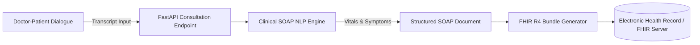

# ClinScribe — Clinical SOAP Documentation & HL7 FHIR Platform 🏥🩺

[](https://fastapi.tiangolo.com/)
[](https://python.org/)
[](https://hl7.org/fhir/)
[](https://docs.pydantic.dev/)
[](LICENSE)

> **ClinScribe** is an ambient clinical intelligence engine and SOAP note transcription platform built with **FastAPI**, **NLP**, and the **HL7 FHIR R4 standard**. Transforms unformatted physician-patient consultations into structured EHR records, extracts vital signs and diagnostic impressions, and compiles compliant FHIR transaction bundles.

---

## 🌟 Key Highlights

- **Ambient Clinical Dialogue Parser**: Rule & heuristic NLP classifier parsing conversations into Subjective, Objective, Assessment, and Plan (SOAP) sections.
- **Automated Vital Signs Extraction**: Regex and NLP pattern recognition detecting Blood Pressure, Heart Rate, Temperature, and SpO2.
- **HL7 FHIR R4 Resource Compiler**: Serializes consultation outputs into standardized FHIR Transaction Bundles (`Patient`, `Encounter`, `Observation`, `Condition`).
- **RESTful High-Performance API**: Asynchronous endpoints with Pydantic v2 validation, OpenAPI documentation, and cross-origin resource sharing (CORS).

---

## 🏗️ System Architecture



---

## 📂 Project Structure

```
ClinScribe/
├── app/
│   ├── main.py            # FastAPI service entrypoint & route handlers
│   ├── nlp_parser.py      # SOAP section classification & vitals regex
│   └── fhir_converter.py  # HL7 FHIR R4 JSON bundle constructor
├── requirements.txt       # Dependencies (FastAPI, Uvicorn, Pydantic)
└── README.md
```

---

## 🛠️ Quick Start

### 1. Setup Environment
```bash
git clone https://github.com/Dk043131/clinscribe.git
cd clinscribe
python3 -m venv venv
source venv/bin/activate
pip install -r requirements.txt
```

### 2. Run API Server
```bash
uvicorn app.main:app --reload --port 8000
```
- Swagger Interactive Docs: `http://localhost:8000/docs`
- Health Check: `http://localhost:8000/health`

### 3. Example Request
```bash
curl -X POST "http://localhost:8000/api/v1/generate-soap" \
     -H "Content-Type: application/json" \
     -d '{
       "patient_id": "PT-10492",
       "transcript": "Patient states severe throbbing headache for 3 days with photophobia. BP: 128/82, HR: 74 bpm. Physical exam reveals no focal neurological deficit. Impression: Acute migraine without aura. Advised sumatriptan 50mg at onset and dark room rest."
     }'
```

---

## 📄 License
This project is open-source under the [MIT License](LICENSE).
